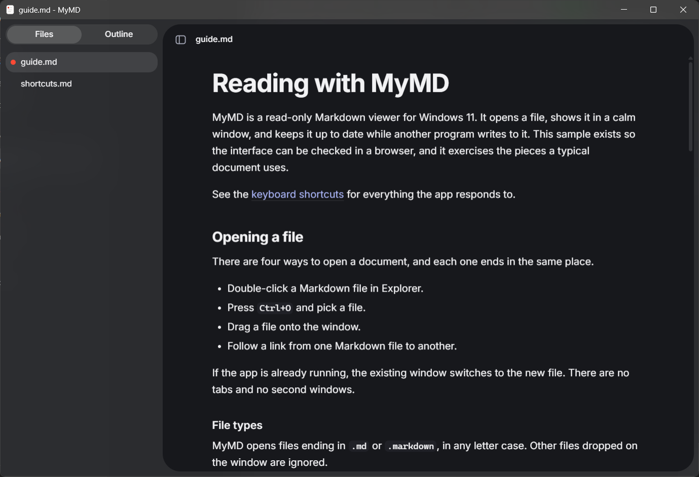

# MyMD

A calm, read-only Markdown viewer for Windows 11. Double-click a `.md` file and read it in a quiet window with frosted glass around the page.



## What it does

- Renders GitHub-style Markdown: tables, task lists, strikethrough, autolinks and fenced code with syntax highlighting
- Shows local and web images, and hides YAML front matter
- Lists the Markdown files in the current folder, and the headings in the current document
- Updates the page when a file changes, and keeps your place
- Finds text on the page, and zooms
- Follows the Windows light or dark setting

MyMD is a viewer, so it never changes your files.

## Install

Download the installer from the [Releases page](https://github.com/askartal/MyMD/releases) and run it. It installs for your user account, so it doesn't ask for administrator rights. MyMD needs Windows 11 on x64.

Releases aren't code-signed yet, so Windows SmartScreen warns you the first time you run a downloaded installer. To continue, choose **More info**, then **Run anyway**.

To make MyMD open Markdown files when you double-click them, right-click a `.md` file, choose **Open with**, pick MyMD, and choose **Always**. Windows doesn't let apps set this themselves. Repeat it for `.markdown` files if you use them.

## Shortcuts

| Keys | Action |
| --- | --- |
| `Ctrl+O` | Open a file |
| `Ctrl+B` | Show or hide the sidebar |
| `Ctrl+F` | Find on the page |
| `Enter`, `Shift+Enter` | Next and previous match |
| `Esc` | Close find or the sidebar drawer |
| `Up`, `Down`, `J`, `K`, `Enter` | Move through and open sidebar items |
| `Ctrl+Plus`, `Ctrl+Minus`, `Ctrl+0` | Zoom in, zoom out and reset |

You can also drag a Markdown file onto the window.

## Privacy

MyMD has no telemetry and no accounts, and it works offline. Web images in a document load from their own hosts, so opening that document can contact those hosts.

A document can't run scripts or start programs. Links open only web pages, mail messages and other Markdown files.

## Build from source

You need [Node.js](https://nodejs.org/), [Rust](https://rustup.rs/) and the [Microsoft C++ Build Tools](https://visualstudio.microsoft.com/visual-cpp-build-tools/). WebView2 comes with Windows 11.

Install the dependencies:

```bash
npm install
```

Run the app:

```bash
npm run tauri dev
```

Run the interface in a browser, with sample documents:

```bash
npm run dev
```

Run the tests:

```bash
npm test
```

```bash
cargo test --manifest-path src-tauri/Cargo.toml
```

Build the installer, which lands in `src-tauri/target/release/bundle/nsis/`:

```bash
npm run tauri build
```

`docs/ARCHITECTURE.md` explains how the code is laid out.

## Contributing

Issues and pull requests are welcome. There's no separate contributing guide.

## License

[MIT](LICENSE). Bundled software and its licenses are listed in [THIRD_PARTY_NOTICES.md](THIRD_PARTY_NOTICES.md).
